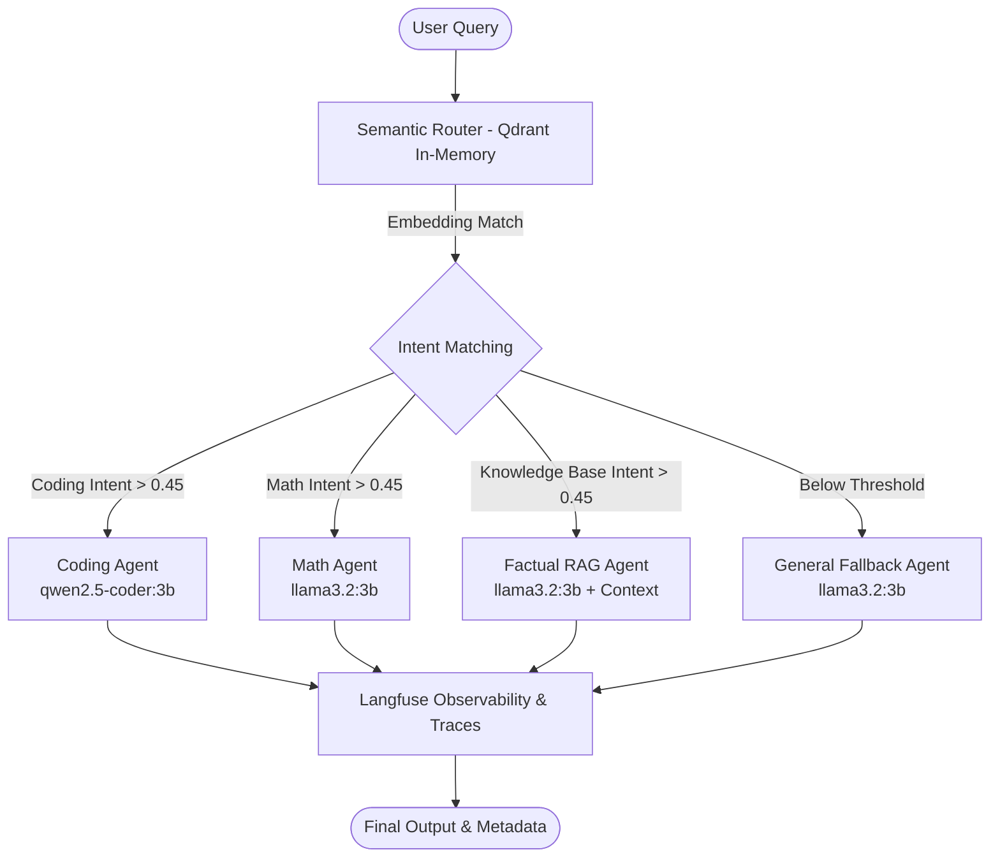

# Semantic Multi-Agent Router 🚀

A high-performance, cost-effective Multi-Agent Router that performs **sub-millisecond semantic intent classification** using an in-memory vector database (**Qdrant**) and dynamically delegates user queries to specialized **Small Language Models (SLMs)** via **Ollama**. Full tracing, latency tracking, and LLM observability are integrated with **Langfuse**, with test-driven evaluations powered by **DeepEval**.

---

## 🌟 Key Highlights

- **⚡ Sub-10ms Semantic Routing**: Uses `sentence-transformers` (`all-MiniLM-L6-v2`) with cosine similarity on an in-memory Qdrant vector index. No bloated LLM routing prompt needed.
- **🎯 Specialized SLM Agents**:
  - `coding_agent`: Backed by `qwen2.5-coder:3b` for fast, optimal code generation.
  - `math_agent`: Backed by `llama3.2:3b` for step-by-step mathematical reasoning.
  - `factual_rag_agent`: Strict RAG assistant answering strictly from enterprise knowledge base context with zero hallucination.
  - `general_fallback_agent`: Fallback agent for out-of-scope or general conversational queries.
- **📊 Production Observability (Langfuse)**: Full execution tracing with `@observe` decorator, logging query input/output, model selection, routing latency, and generation latency.
- **🧪 LLM Evaluation (DeepEval)**: Automated testing for routing accuracy, answer relevancy, and retrieval faithfulness.
- **🪶 Zero Docker / Zero Cloud DB Dependency**: Qdrant runs entirely in RAM (`:memory:`), providing blazing-fast lookups with zero infra setup.

---

## 🏗️ Architecture Flow



---

## 📂 Project Structure

```bash
semantic-multi-agent-router/
├── router.py          # SemanticRouter using SentenceTransformers & Qdrant (:memory:)
├── agents.py          # Specialized SLM agents configuration and Ollama executor
├── main.py            # End-to-end workflow orchestration with Langfuse tracing
├── test_evals.py      # DeepEval unit tests for routing accuracy & faithfulness
├── requirements.txt   # Python dependencies
├── .env.example       # Template for environment configuration
└── .gitignore         # Git ignore rules for keys, caches, and virtualenv
```

---

## 🚀 Quickstart Guide

### 1. Prerequisites
- **Python 3.10+**
- **[Ollama](https://ollama.com/)** installed and running on your system.

Pull the required SLM models:
```bash
ollama pull qwen2.5-coder:3b
ollama pull llama3.2:3b
```
Ensure Ollama service is active:
```bash
ollama serve
```

### 2. Installation
Clone the repository and set up a virtual environment:
```bash
git clone https://github.com/AryanPROOO/semantic_multi_agent_router.git
cd semantic_multi_agent_router

python3 -m venv venv
source venv/bin/activate
pip install -r requirements.txt
```

### 3. Environment Configuration
Create a `.env` file from the example:
```bash
cp .env.example .env
```
Add your **[Langfuse](https://cloud.langfuse.com/)** API credentials:
```env
LANGFUSE_PUBLIC_KEY="pk-lf-..."
LANGFUSE_SECRET_KEY="sk-lf-..."
LANGFUSE_HOST="https://us.cloud.langfuse.com"
LANGFUSE_BASE_URL="https://us.cloud.langfuse.com"
```

---

## 🏃 Running the Application

Execute the main pipeline:
```bash
python main.py
```

### Sample Output
```text
============================================================
Query : Write a Python function for Kadane's algorithm.
Routed Agent : coding_agent (Confidence: 0.945)
SLM Model : qwen2.5-coder:3b
Routing Latency : 8.12 ms
Total Latency : 1940.4 ms
Response Snippet : Certainly! Kadane's algorithm is an efficient way to find the maximum sum...

============================================================
Query : What is the refund policy and enterprise rate limit?
Routed Agent : factual_rag_agent (Confidence: 0.664)
SLM Model : llama3.2:3b
Routing Latency : 12.35 ms
Total Latency : 1650.1 ms
Response Snippet : The refund policy is as follows: Full refunds are processed within 14 days...
```

---

## 📊 Observability with Langfuse

Every execution automatically pushes spans and traces to Langfuse:
- **`Multi_Agent_Workflow`**: Overall trace tracking end-to-end user request latency.
- **`Qdrant_Semantic_Router`**: Tracks cosine similarity confidence scores and routing time.
- **`Specialized_SLM_Execution`**: Logs generation duration, prompt tokens, and model metadata.

---

## 🧪 Evaluation & Testing

Run unit tests and LLM evaluation metrics with pytest & DeepEval:
```bash
pytest test_evals.py -v
```
- **`test_routing_accuracy`**: Verifies queries land on expected domain agents.
- **`test_factual_consistency_and_relevancy`**: Evaluates hallucination and adherence to context using `FaithfulnessMetric` and `AnswerRelevancyMetric`.

---

## 📜 License
MIT License. Free to use, adapt, and build upon.